 <picture> <source media="(prefers-color-scheme: dark)" srcset="./dark.svg"> <source media="(prefers-color-scheme: light)" srcset="./light.svg">  </picture> 

👋 À propos

Étudiante en Master 2 Data Science & Software Development à l'ESEN (Manouba, Tunis). Diplômée en 2025 d'une Licence en Informatique de Gestion (spécialité Business Intelligence), je recherche un stage de fin d'études (PFE) en Data Science.

💼 Expérience
Stagiaire, TOPNET (août – sept. 2026) : Direction Marché d'Entreprise, Département Administration des Ventes (stage saisonnier)
Stagiaire en Business Intelligence, Tunisie Télécom (févr. – avr. 2025) : projet de fin d'études de la licence : entrepôt de données (modèle en étoile), ETL avec Talend, prédiction du churn clients (Machine Learning), reporting des KPI
🎓 Formation
Master Data Science & Software Development : ESEN, Manouba (2026 – en cours)
Licence en Informatique de Gestion (Business Intelligence) : ESEN, Manouba (2022 – 2025)
🚀 Projets
Projet	Description
Covoiturage	Application de covoiturage en C# WPF avec architecture en couches et Entity Framework Core (SQL Server) : gestion des utilisateurs, des trajets, des voitures et des réservations
DataMart Northwind	Schéma en étoile sous MySQL, jobs ETL Talend, tableau de bord Power BI multi-pages avec mesures DAX
Prédiction du chômage en Tunisie	Modèles de régression en R à partir d'indicateurs macroéconomiques, ggplot2 et R Markdown
Marché immobilier en France	Nettoyage avec pandas et NumPy, tendances des prix avec matplotlib et seaborn
Performances des fabricants VanArsdel	Tableau de bord Power BI interactif sur les revenus et la croissance
Site e-commerce	Boutique de cosmétiques en ligne : développement web et conception de la base de données
Application de gestion commerciale	Application Java modélisée en UML (clients, articles, commandes)
<!-- Quand chaque dépôt est public, ajoute son lien dans le tableau ci-dessus. -->
🛠️ Stack

Afficher l'image Afficher l'image Afficher l'image Afficher l'image Afficher l'image Afficher l'image Afficher l'image Afficher l'image Afficher l'image Afficher l'image Afficher l'image Afficher l'image Afficher l'image

📜 Certifications

 
Voir les 13 certifications

Apprendre l'analyse des données, parties 1 et 2 (LinkedIn Learning)
Power BI for Beginners (Simplilearn)
R Programming for Beginners (Simplilearn)
Introduction to DAX in Power BI (DataCamp)
Introduction to Python, Intermediate Python, Data Manipulation with pandas (DataCamp)
MongoDB Associate Developer, Python
Data Science Essentials with Python, Data Analytics Essentials (Cisco Networking Academy)
Intro to NLP for AI (365 DataScience)
Generative AI and LLMs: Architecture and Data Preparation (Coursera, IBM)

<h2 align="center">📊 Contributions GitHub</h2> 
 <picture> <source media="(prefers-color-scheme: dark)" srcset="https://raw.githubusercontent.com/MalakSaidani26/github-snake/output/github-snake-dark.svg" /> <source media="(prefers-color-scheme: light)" srcset="https://raw.githubusercontent.com/MalakSaidani26/github-snake/output/github-snake.svg" />  </picture> 

📫 Me contacter
LinkedIn : malak-saidani
Email : malak.saidani@esen.tn
GitHub : @MalakSaidani26
